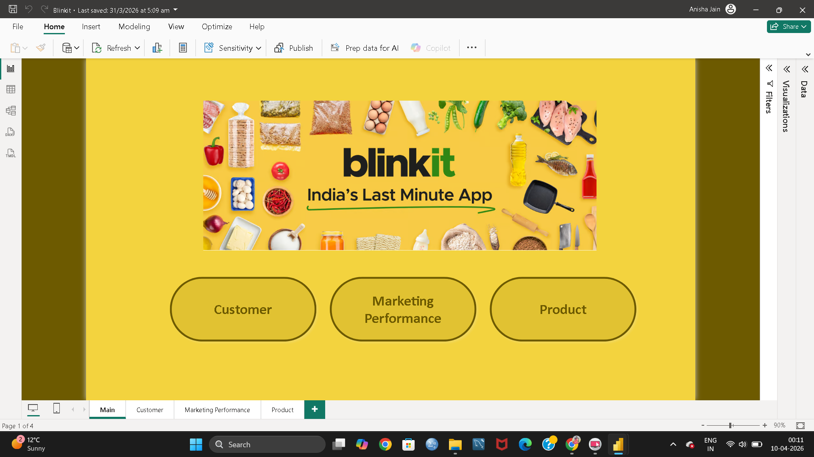
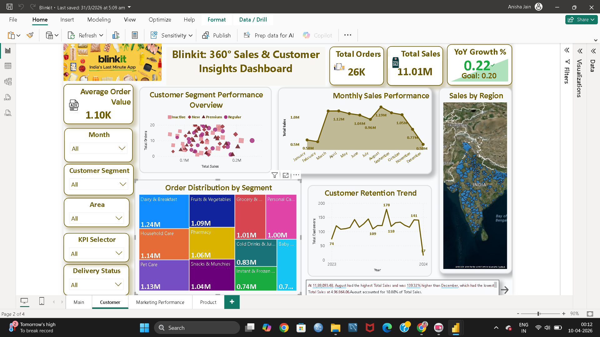
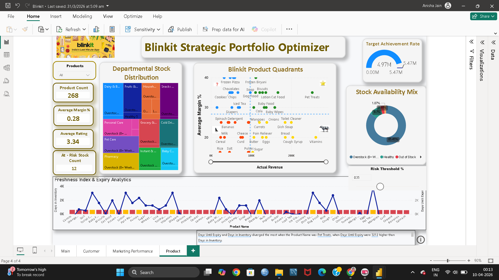

# Blinkit 360°: Strategic Growth & Operations Hub

## 📊 Project Overview
This project is an end-to-end **Power BI** analytical suite designed to provide a 360-degree view of Blinkit’s business performance. By integrating sales, marketing, and inventory data, this dashboard enables stakeholders to make data-driven decisions on stock management, customer retention, and marketing ROI.

## 🖼️ Dashboard Preview
| Page | Description |
| :--- | :--- |
| **Main** | Interactive navigation hub using bookmarks and buttons. |
| **Customer** | Behavioral mapping, retention trends, and segment performance. |
| **Marketing** | Conversion efficiency, ROAS analysis, and channel attribution. |
| **Product** | BCG Matrix, stock availability, and expiry/freshness analytics. |

## 📸 Dashboard Screenshots

### Main Page

### Customer Page

### Marketing Page

### Product Page

### Data Model — Snowflake Schema

